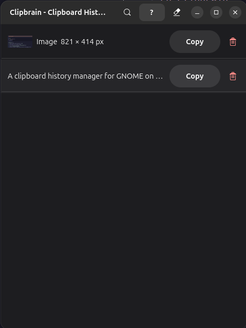

# Clipbrain

A clipboard history manager for GNOME on Wayland, built with Rust, GTK4, and libadwaita.



## Features

- **Text and image history** — captures everything you copy, up to 200 entries
- **Deduplication** — re-copying existing content moves it to the top rather than duplicating it
- **Password-manager aware** — skips content marked secret (e.g. passwords copied from KeePassXC)
- **Search** — filter history instantly with Ctrl+F
- **System tray** — runs in the background; window hides on close
- **Persistent** — history survives restarts

## Requirements

- GNOME on Wayland (the tray icon needs the AppIndicator extension, which Ubuntu enables by default)
- GTK ≥ 4.22 and libadwaita ≥ 1.9
- Debian/Ubuntu-based system (apt) — the installer handles everything else, including Rust

## Installation

```bash
git clone <repo-url>
cd clipbrain
./install.sh
```

`install.sh` will:
1. Install missing build dependencies via `apt` (`libgtk-4-dev`, `libadwaita-1-dev`, `pkg-config`, `build-essential`)
2. Install Rust via [rustup](https://rustup.rs) if `cargo` isn't available
3. Build with `cargo build --release`
4. Install `~/.local/bin/clipbrain`, the desktop file, and the app icon
5. Optionally register a GNOME keyboard shortcut and an autostart entry

## Running

```bash
clipbrain
```

Or without installing:

```bash
cargo run
```

Set `CLIPBRAIN_LOG=debug` for verbose logging (it's quiet by default).

## Usage

Press your GNOME shortcut (e.g. **Super+V**) or click the tray icon to open the history window. Press **Enter** or click an entry's copy button to put it back on the clipboard.

## Keyboard Shortcuts

| Key | Action |
|---|---|
| `Ctrl+Shift+V` | Show history window |
| `↓` / `j` | Select next item |
| `↑` / `k` | Select previous item |
| `Enter` | Copy selected item to clipboard |
| `Space` | Preview selected item in full (`j`/`k` step through entries, `Enter` copies, `Space`/`Escape` close) |
| `Delete` | Delete selected item |
| `Ctrl+F` / `/` | Search history |
| `Escape` | Close search (or hide the window) |
| `?` / `F1` | Show keyboard shortcuts |
| `Ctrl+Shift+Delete` | Clear all history |

While typing in the search box, `j`, `k`, `?`, `Space` and `Delete` type or edit text as usual.

## Data

History lives in `~/.local/share/clipbrain/` (or `$XDG_DATA_HOME/clipbrain/`): `history.json` plus `images/<id>.png`. The directory is private to your user. The format is the same one the earlier Python version used, so existing history carries over.

## Architecture

| File | Role |
|---|---|
| `src/main.rs` | Entry point; selects the X11 backend and registers resources |
| `src/app.rs` | `AdwApplication` subclass; wires monitor, window, tray |
| `src/monitor.rs` | Clipboard watcher; `changed` signal + 500 ms poll |
| `src/storage.rs` | JSON index + PNG files; no GTK, unit-tested |
| `src/entry.rs` | `ClipEntry` GObject and thumbnail loading |
| `src/window/` | `AdwApplicationWindow`; hides on close, never destroyed |
| `src/tray.rs` | In-process StatusNotifierItem tray icon (`ksni`) |
| `resources/` | UI templates, icon, desktop file |
| `install.sh` | Full installer |

## License

MIT
